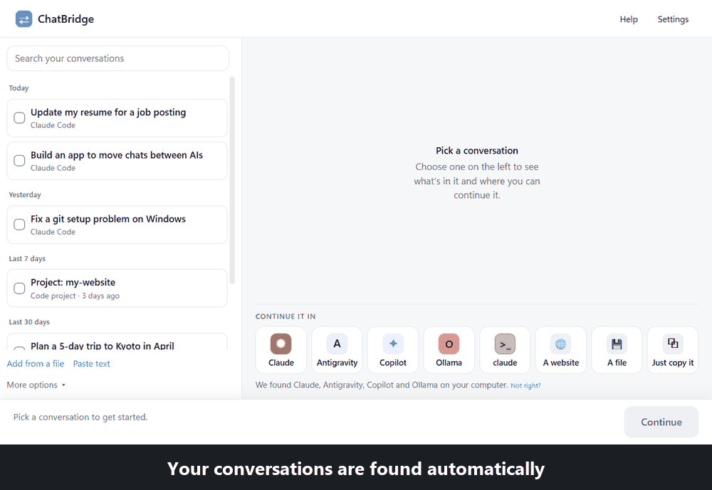
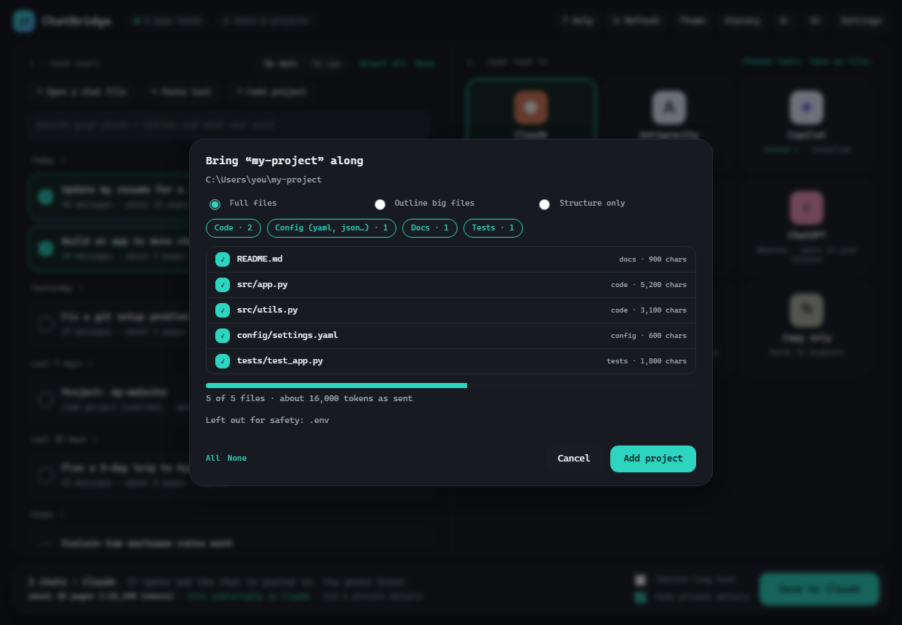
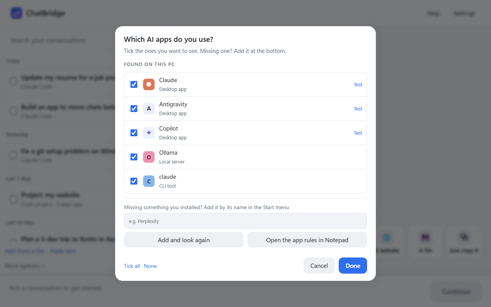
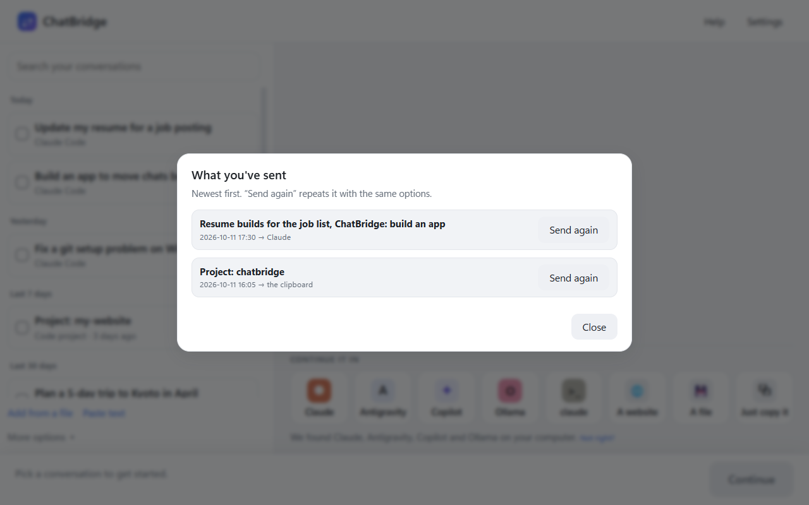
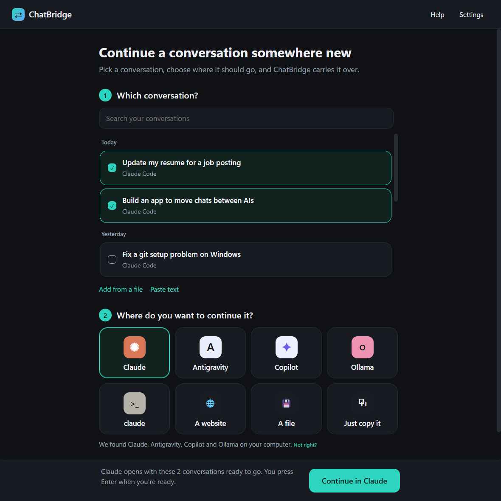

# ChatBridge

**Move a conversation — or a whole code project — from one AI app to another, without starting over.**

  

You started a conversation in one AI and want to continue it in another — or hand a project to a new model. Today that means
copying and pasting, losing context, and re-explaining everything. ChatBridge does it in three simple steps.



*The animation uses sample conversations, not real ones.*

## How it works

1. **Pick a conversation** — ChatBridge lists the conversations it found on your PC on the left (add more from a file or by pasting text). Click one to open it.
2. **Choose where to continue it** — on the right: one of your AI apps (shown with its real icon), **a website** (ChatGPT, Claude.ai, Gemini and others), **a file**, or just copy it.
3. **Press the big button** — the app opens and the conversation is put in place. **You read it and press Enter yourself.**

## Features

- **Finds your AI apps** — Claude, ChatGPT, Copilot, Antigravity, local models such as Ollama, and more. Installed something new? Open
  *More options* and press **Look again**.
- **Websites and files** — pick a site from a short list and the conversation is copied (and saved as a file in case a site won't take
  a long paste); or save it as Markdown, text or a re-importable file.
- **Easy to browse** — readable names, grouped by date, with search that looks inside the conversations.
- **Finds your chats** — those stored on this PC (Claude Code, Codex, Gemini CLI, LM Studio, Jan), and imports ChatGPT and Claude
  exports, pasted text and markdown.
- **Saves web chats in one click** with the included browser extension (ChatGPT, Claude.ai, Gemini).
- **Moves just part of a chat** — a long conversation opens as a notebook of sections you can tick, rename and send on their own,
  with a short outline of the rest; it can be pasted into a chat you already have open.
- **Moves whole projects** — code, markdown, YAML and other config files, with a folder tree, a live size meter, and a choice of
  *full files*, *outlines of big files*, or *structure only* (*More options → Bring a code project*).
- **Looks after you** — passwords, keys, emails and your Windows user name are hidden automatically, and very long conversations are
  shortened only when they need to be.
- **History** and **drag and drop** (drag a conversation onto an app); the place you used last is remembered.
- **Light by default**, with dark colors and a code-style font in Settings.



| | |
|---|---|
|  |  |
|  | |

> The screenshots use sample data and placeholder icons. On your PC ChatBridge shows each app's real icon, taken from Windows.

## Install

Download **`ChatBridge-Setup.exe`** from the [Releases](../../releases) page and run it. It installs for your Windows account
only and needs no administrator rights. It also installs an uninstaller you can reach from *Settings → Apps*.

### If Windows says "Windows protected your PC"
ChatBridge is new and not code-signed yet, so Windows SmartScreen shows a blue or red box for any program it hasn't seen
many times before. It doesn't mean something is wrong. To continue, click **More info**, then **Run anyway**.
Each release lists a SHA-256 checksum (`SHA256SUMS.txt`) if you want to verify the download first. Free code signing has been applied
for (see [Code signing policy](#code-signing-policy)), which will remove the warning.

**Requirements:** Windows 10 or 11 with the Microsoft Edge WebView2 runtime (already included in Windows 11).

## Browser extension (optional)

1. Open `edge://extensions` (or `chrome://extensions`) and turn on **Developer mode**.
2. Click **Load unpacked** and choose the `extension` folder (ChatBridge → Settings → *Open extension folder* opens it).
3. In ChatBridge → Settings → **Browser capture**, click **Copy code**, then paste it into the extension's options page.

A *Save to ChatBridge* button then appears on ChatGPT, Claude.ai and Gemini. The extension only talks to ChatBridge on your own
PC, and only after you click the button.

## Code signing policy

Windows shows an "unknown publisher" warning for programs it hasn't seen often. ChatBridge has applied for free code signing from the
[SignPath Foundation](https://signpath.org); until that is approved, releases are unsigned (you can still check the SHA-256 in each
release). Who signs, how builds are made, and what is signed are described in [CODE_SIGNING_POLICY.md](CODE_SIGNING_POLICY.md).

## Privacy and safety

- Everything stays on your PC: no account, no analytics, no servers. See [PRIVACY.md](PRIVACY.md).
- The only network request is an optional once-a-day check for a newer version (you can turn it off).
- ChatBridge **never presses Enter** and never sends a message for you.
- Project folders: `.env` files, key files, and any file that looks like it contains a key or password are left out automatically.

## Adding or fixing an app

Each app's behaviour — its window title, its "new chat" shortcut, whether to paste the chat or hand over a file — is one entry in
an editable list (ChatBridge → *Edit app list*). Keys like `ctrl+shift+l` are allowed; **Enter is refused**. If an app doesn't
work, please [open an issue](../../issues/new/choose) — it's usually a one-line fix.

## Build from source

Python 3.9+ on Windows:

```bash
pip install pywebview pyinstaller pillow
python chatbridge_app.py                      # run it
python -m unittest discover -s tests -v       # 80 tests
python make_release.py                        # tests, then build the app and the installer into release/
```

Set `CHATBRIDGE_GUI_TESTS=1` to also run tests that open a fake chat window (they briefly use the clipboard and keyboard).
Releasing is described in [RELEASING.md](RELEASING.md).

## License

[MIT](LICENSE). ChatBridge is an independent project and is not affiliated with or endorsed by any AI company. Product names
are trademarks of their owners.
